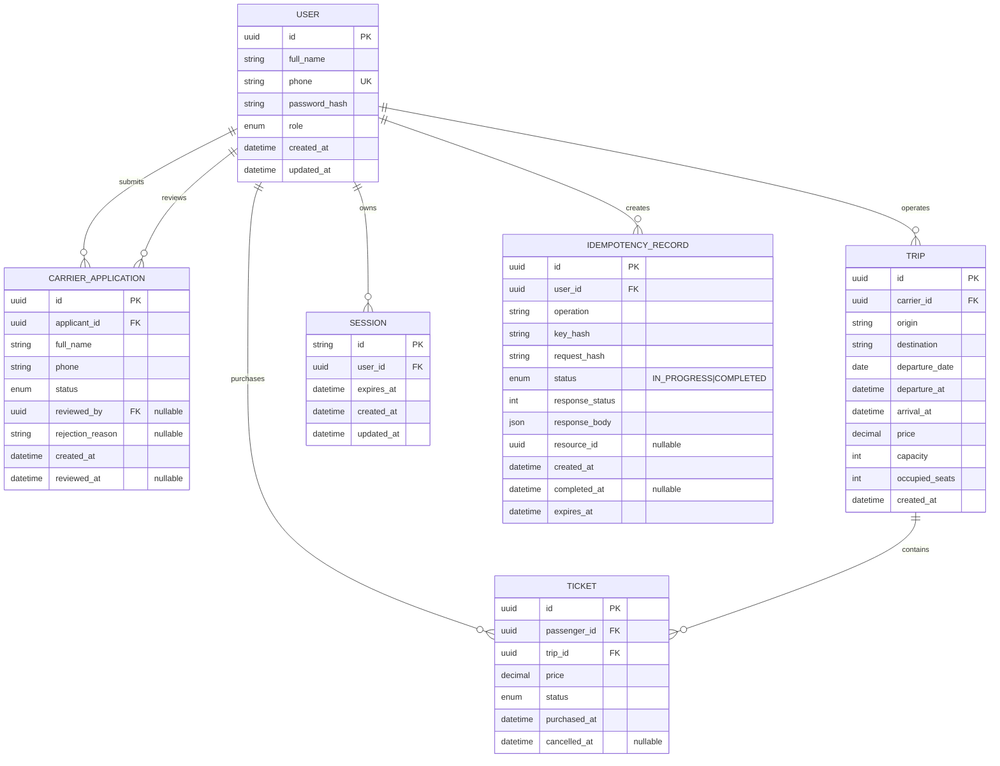

# ER diagram

Логічна модель даних AutobusUA. Документ деталізує модель, винесену за межі
специфікації, щоб не збільшувати її обсяг. Типи наведені в термінах
PostgreSQL; схема підтримується SQL-міграціями, а доступ виконується через
`pg` і repository layer.

## Diagram



## Entities

### `User`

Обліковий запис користувача. `role` має значення `PASSENGER`, `CARRIER` або
`ADMIN`. Пароль зберігається лише як Argon2id-хеш. Номер телефону нормалізується
перед збереженням; `phone` має бути унікальним.

### `CarrierApplication`

Заявка на роль перевізника. Містить лише ПІБ і номер телефону; документи,
завантаження файлів і KYC до моделі не входять. `status` має значення `PENDING`,
`VERIFIED` або `REJECTED`.

`applicant_id` посилається на користувача, який подав заявку. `reviewed_by`
посилається на адміністратора і заповнюється під час рішення. Для `PENDING`
заявки `reviewed_by`, `reviewed_at` і `rejection_reason` мають бути `NULL`.
Для `REJECTED` можна зберігати причину відхилення.

На рівні бази даних має бути забезпечено не більше однієї активної
`PENDING` заявки на користувача через partial unique index:

```sql
CREATE UNIQUE INDEX carrier_application_one_pending_per_user
ON carrier_application (applicant_id)
WHERE status = 'PENDING';
```

### `Trip`

Одноразовий опублікований рейс. Рейс створюється одразу з усіма даними та не
має статусу чернетки. `carrier_id` посилається на підтвердженого перевізника.
Часові значення зберігаються з урахуванням `Europe/Kyiv`.

`capacity` має бути додатним, `occupied_seats` не може бути від'ємним і не
може перевищувати `capacity`. Оскільки сегментація та вибір конкретного місця
вилучені зі scope, один рейс має один спільний лічильник зайнятих місць.

### `Ticket`

Квиток користувача на весь рейс. І `PASSENGER`, і `CARRIER` можуть купувати
квитки як пасажири. `price` є копією ціни на момент купівлі та не залежить від
подальших змін у довідкових даних. `status` має значення `ACTIVE` або
`CANCELLED`.

Один користувач не може придбати більше одного активного квитка на той самий
рейс. Це забезпечується partial unique index:

```sql
CREATE UNIQUE INDEX ticket_one_active_per_passenger_trip
ON ticket (passenger_id, trip_id)
WHERE status = 'ACTIVE';
```

У назві поля `passenger_id` зберігається історична модель: воно посилається на
будь-якого користувача, який купив квиток, включно з користувачем ролі
`CARRIER`.

### `Session`

Серверна сесія користувача. Ідентифікатор сесії зберігається в cookie, а стан
сесії — у PostgreSQL. Прострочені сесії не повинні надавати доступ до
захищених операцій.

### `IdempotencyRecord`

Запис результату повторюваної state-changing операції. Для безпеки
зберігаються хеші ключа та нормалізованого payload, а не обов'язково
оригінальний ключ. `status` має значення `IN_PROGRESS` або `COMPLETED`.
`operation` розрізняє тип операції, а унікальність визначається за
`(user_id, operation, key_hash)`.

Для покупки квитка запис і бізнес-зміни фіксуються в одній транзакції. Повтор
із тим самим ключем і payload повертає збережений результат. Повтор із іншим
payload отримує `409 Conflict`. Записи мають `expires_at` і можуть бути
очищені після завершення строку дії.

Рекомендований індекс ідемпотентності:

```sql
CREATE UNIQUE INDEX idempotency_record_operation_key
ON idempotency_record (user_id, operation, key_hash);
```

## Retry and connection lifecycle

Під час запуску DatabaseModule створює singleton connection pool, виконує
`SELECT now()` і не дозволяє застосунку почати прийом HTTP-запитів, якщо
перевірка неуспішна. Startup connection retry обмежений трьома спробами.
Repositories отримують pool через DI. Для транзакцій вони беруть client через
`pool.connect()`, використовують той самий client для всіх команд і викликають
`release()` у кожному завершенні. Під час shutdown виконується `pool.end()`.

Для PostgreSQL serialization failure (`40001`) і deadlock (`40P01`) повторюється
вся транзакція максимум тричі з backoff `25 ms`, `50 ms`, `100 ms` і jitter.
Такий retry дозволений лише для read-only або ідемпотентних операцій.
Runtime connection failure після початку транзакції не повторюється, якщо
результат `COMMIT` невідомий. Validation, authorization, not found,
constraint, syntax і permission errors автоматично не повторюються.

## Key constraints and transactions

1. **Купівля квитка:** транзакція блокує рядок `Trip` через `SELECT ... FOR
   UPDATE`, перевіряє `occupied_seats < capacity`, створює `Ticket` і збільшує
   `occupied_seats`. Усі зміни фіксуються одним `COMMIT`.
2. **Конкурентна купівля:** паралельні транзакції для одного рейсу
   серіалізуються на блокуванні `Trip`. Лише одна транзакція може успішно зайняти
   останнє місце; інша бачить актуальну місткість і завершується помилкою.
3. **Скасування:** транзакція блокує `Trip`, перевіряє власника, статус
   `ACTIVE` і час до відправлення, змінює квиток на `CANCELLED` та зменшує
   `occupied_seats`.
4. **Інваріанти:** `0 <= occupied_seats <= capacity`; скасування не може
   зменшити лічильник двічі; скасований квиток не можна скасувати повторно.
5. **Видалення:** рейси та користувачі з пов'язаними квитками не видаляються
   каскадно. Для історії купівель потрібне контрольоване видалення або
   деактивація на рівні сервісу.
6. **Незмінність рейсу:** після створення рейс не редагується і не видаляється
   через API. Це зберігає історію квитків і спрощує інваріанти місткості.
7. **Ролі квитка:** `PASSENGER` і `CARRIER` мають однакові права на власні
   квитки: купівля, перегляд і скасування. Роль `CARRIER` додатково дозволяє
   створювати власні рейси.

## Relationship summary

| Relationship | Cardinality | Rule |
|---|---:|---|
| `User` → `CarrierApplication` | 1:N | Не більше однієї `PENDING` заявки |
| `User` → `Trip` | 1:N | Створює лише підтверджений перевізник |
| `User` → `Ticket` | 1:N | Не більше одного `ACTIVE` квитка на рейс |
| `Trip` → `Ticket` | 1:N | Кількість активних квитків не перевищує capacity |
| `User` → `Session` | 1:N | Сесії мають строк дії |
| `User` → `CarrierApplication` (reviewer) | 1:N | Reviewer має роль `ADMIN` |
| `User` → `IdempotencyRecord` | 1:N | Ключ унікальний у межах операції |

## API contract details

### Authentication and roles

Сесія передається через HttpOnly cookie `autobusua_session`. Реєстрація
створює користувача з роллю `PASSENGER`. Підтвердження заявки атомарно змінює
роль користувача на `CARRIER`. Авторизація перевіряється до виконання
business service.

### Main endpoints

| Method | Path | Access | Purpose |
|---|---|---|---|
| `POST` | `/api/v1/auth/register` | Public | Реєстрація |
| `POST` | `/api/v1/auth/login` | Public | Створення сесії |
| `POST` | `/api/v1/auth/logout` | Authenticated | Завершення сесії |
| `GET` | `/api/v1/auth/me` | Authenticated | Поточний користувач |
| `POST` | `/api/v1/carrier-applications` | Authenticated non-carrier | Подання заявки |
| `GET` | `/api/v1/carrier-applications/me` | Authenticated | Власні заявки |
| `GET` | `/api/v1/carrier-applications` | `ADMIN` | Список заявок |
| `POST` | `/api/v1/carrier-applications/:id/approve` | `ADMIN` | Підтвердження |
| `POST` | `/api/v1/carrier-applications/:id/reject` | `ADMIN` | Відхилення |
| `GET` | `/api/v1/trips` | Public | Пошук рейсів |
| `GET` | `/api/v1/trips/:id` | Public | Деталі рейсу |
| `POST` | `/api/v1/trips` | `CARRIER` | Створення рейсу |
| `GET` | `/api/v1/trips/mine` | `CARRIER` | Власні рейси |
| `POST` | `/api/v1/trips/:tripId/tickets` | `PASSENGER`, `CARRIER` | Купівля |
| `GET` | `/api/v1/tickets/me` | `PASSENGER`, `CARRIER` | Власні квитки |
| `GET` | `/api/v1/tickets/:id` | Owner, `ADMIN` | Деталі квитка |
| `POST` | `/api/v1/tickets/:id/cancel` | Owner | Скасування |

Створення рейсу не має update/delete endpoint-ів. Для покупки, подання заявки,
створення рейсу та інших state-changing операцій, де повтор може створити
дубль, використовується `Idempotency-Key`. Для реєстрації він не потрібен:
унікальний номер телефону захищений constraint-ом.

### Pagination and query rules

Списки використовують `page` (за замовчуванням `1`) і `pageSize` (за
замовчуванням `20`, максимум `100`). Authorization та бізнес-фільтри
застосовуються в `WHERE`, після чого виконується стабільне `ORDER BY` і
`LIMIT/OFFSET`. Для рейсів пасажир бачить лише майбутні рейси з доступними
місцями, перевізник — власні рейси, а адміністратор — дозволений
адміністративний scope.
