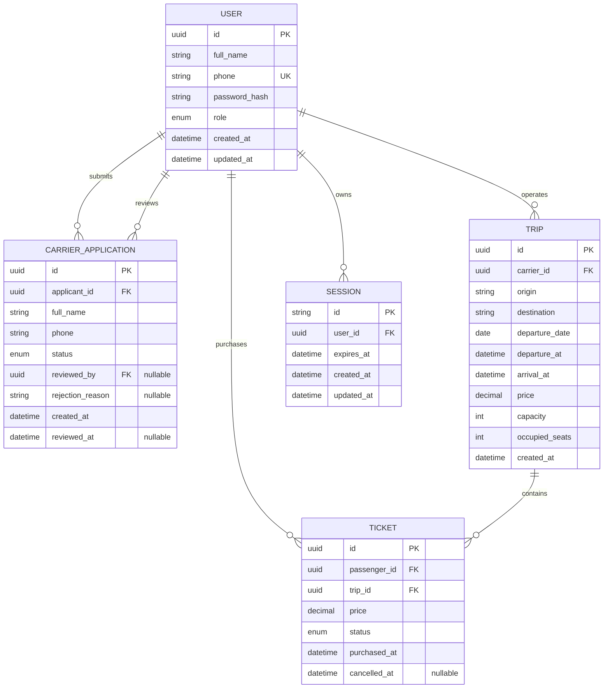

# ER diagram

Логічна модель даних AutobusUA. Документ деталізує модель, винесену за межі
специфікації, щоб не збільшувати її обсяг. Типи наведені в термінах
PostgreSQL/Prisma; остаточний синтаксис Prisma визначається під час реалізації.

## Diagram



## Entities

### `User`

Обліковий запис користувача. `role` має значення `PASSENGER`, `CARRIER` або
`ADMIN`. Пароль зберігається лише як Argon2id-хеш. Номер телефону нормалізується
перед збереженням; `phone` має бути унікальним.

### `CarrierApplication`

Заявка на роль перевізника. Містить лише ПІБ і номер телефону; документи,
завантаження файлів і KYC до моделі не входять. `status` має значення `PENDING`,
`VERIFIED` або `REJECTED`.

`applicant_id` посилається на користувача, який подав заявку. `reviewed_by`
посилається на адміністратора і заповнюється під час рішення. Для `PENDING`
заявки `reviewed_by`, `reviewed_at` і `rejection_reason` мають бути `NULL`.
Для `REJECTED` можна зберігати причину відхилення.

На рівні бази даних має бути забезпечено не більше однієї активної
`PENDING` заявки на користувача через partial unique index:

```sql
CREATE UNIQUE INDEX carrier_application_one_pending_per_user
ON carrier_application (applicant_id)
WHERE status = 'PENDING';
```

### `Trip`

Одноразовий опублікований рейс. Рейс створюється одразу з усіма даними та не
має статусу чернетки. `carrier_id` посилається на підтвердженого перевізника.
Часові значення зберігаються з урахуванням `Europe/Kyiv`.

`capacity` має бути додатним, `occupied_seats` не може бути від'ємним і не
може перевищувати `capacity`. Оскільки сегментація та вибір конкретного місця
вилучені зі scope, один рейс має один спільний лічильник зайнятих місць.

### `Ticket`

Квиток пасажира на весь рейс. `price` є копією ціни на момент купівлі та не
залежить від подальших змін у довідкових даних. `status` має значення `ACTIVE`
або `CANCELLED`.

Один користувач не може придбати більше одного активного квитка на той самий
рейс. Це забезпечується partial unique index:

```sql
CREATE UNIQUE INDEX ticket_one_active_per_passenger_trip
ON ticket (passenger_id, trip_id)
WHERE status = 'ACTIVE';
```

### `Session`

Серверна сесія користувача. Ідентифікатор сесії зберігається в cookie, а стан
сесії — у PostgreSQL. Прострочені сесії не повинні надавати доступ до захищених
операцій.

## Key constraints and transactions

1. **Купівля квитка:** транзакція блокує рядок `Trip` через `SELECT ... FOR
   UPDATE`, перевіряє `occupied_seats < capacity`, створює `Ticket` і збільшує
   `occupied_seats`. Усі зміни фіксуються одним `COMMIT`.
2. **Конкурентна купівля:** паралельні транзакції для одного рейсу
   серіалізуються на блокуванні `Trip`. Лише одна транзакція може успішно зайняти
   останнє місце; інша бачить актуальну місткість і завершується помилкою.
3. **Скасування:** транзакція блокує `Trip`, перевіряє власника, статус
   `ACTIVE` і час до відправлення, змінює квиток на `CANCELLED` та зменшує
   `occupied_seats`.
4. **Інваріанти:** `0 <= occupied_seats <= capacity`; скасування не може
   зменшити лічильник двічі; скасований квиток не можна скасувати повторно.
5. **Видалення:** рейси та користувачі з пов'язаними квитками не видаляються
   каскадно. Для історії купівель потрібне контрольоване видалення або
   деактивація на рівні сервісу.

## Relationship summary

| Relationship | Cardinality | Rule |
|---|---:|---|
| `User` → `CarrierApplication` | 1:N | Не більше однієї `PENDING` заявки |
| `User` → `Trip` | 1:N | Створює лише підтверджений перевізник |
| `User` → `Ticket` | 1:N | Не більше одного `ACTIVE` квитка на рейс |
| `Trip` → `Ticket` | 1:N | Кількість активних квитків не перевищує capacity |
| `User` → `Session` | 1:N | Сесії мають строк дії |
| `User` → `CarrierApplication` (reviewer) | 1:N | Reviewer має роль `ADMIN` |
